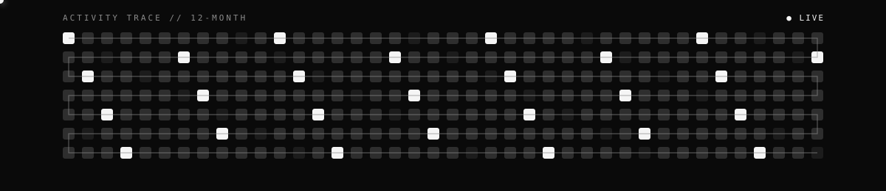

 

---

### `>` currently

building at the intersection of **applied AI** and **prediction markets** — shipping agents, quant tooling, and products people actually use. undergrad at [minerva university](https://www.minerva.edu), based in san francisco.

### `>` selected builds

| project | what it does | stack |
|--------:|--------------|-------|
| [**minerva-compass**](https://github.com/ibrhmyi/minerva-compass) | AI-powered admissions assistant for Minerva applicants | `ts` `llm` |
| [**coworker**](https://github.com/ibrhmyi/coworker) | Claude plugin bridging Cowork ⇄ Code — 90% fewer tokens in the orchestrator's context | `ts` `agents` |
| [**momentum-arb**](https://github.com/ibrhmyi/momentum-arb) | Polymarket velocity signals → Kalshi execution bot + live dashboard | `ts` `quant` |
| [**one_percent**](https://github.com/ibrhmyi/one_percent) | hunts near-resolution sports markets with mispriced tails | `ts` `data` |
| [**DobbyForge**](https://github.com/ibrhmyi/DobbyForge) | character-model experimentation playground | `py` `ml` |

### `>` signal

 

### `>` toolbox

---

*“i sometimes think too much” — then i ship it.*

