## Hi, I'm Ibrahim

CS (Data Science) at [Minerva University](https://www.minerva.edu/) in San Francisco, minor in Economics. Website: [iyildiz.me](https://iyildiz.me)

### Now
- Research Software Engineer at the University of Buenos Aires, working on [mispitools](https://cran.r-project.org/package=mispitools), a CRAN-published R/C++ package for Bayesian forensic identification (CI/CD, tests, Shiny).
- Building [onepercent.markets](https://onepercent.markets), an edge-detection terminal for prediction markets.
- [insider](https://github.com/ibrhmyi/insider): a pre-registered pilot study on detecting unusual trading activity on Polymarket, with frozen rules and nulls reported.

### Open source
Open pull requests on prediction-market tooling, including [pmxt](https://github.com/pmxt-dev/pmxt) (SDK fixes and docs), kalshi-trading-bot-cli and socialpredict.

### Stack
Python, R, SQL, TypeScript, JavaScript · PyTorch, TensorFlow, pandas, scikit-learn, Spark · React, Next.js · AWS, Docker, PostgreSQL

### Past
Co-founder of Tourfly (B2B SaaS for charter flights) and Miselium (headless CMS, CES 2024) · Data Science Fellow at Los Alamos National Lab · hackathon wins at NASA, CalHacks and SentientAGI
